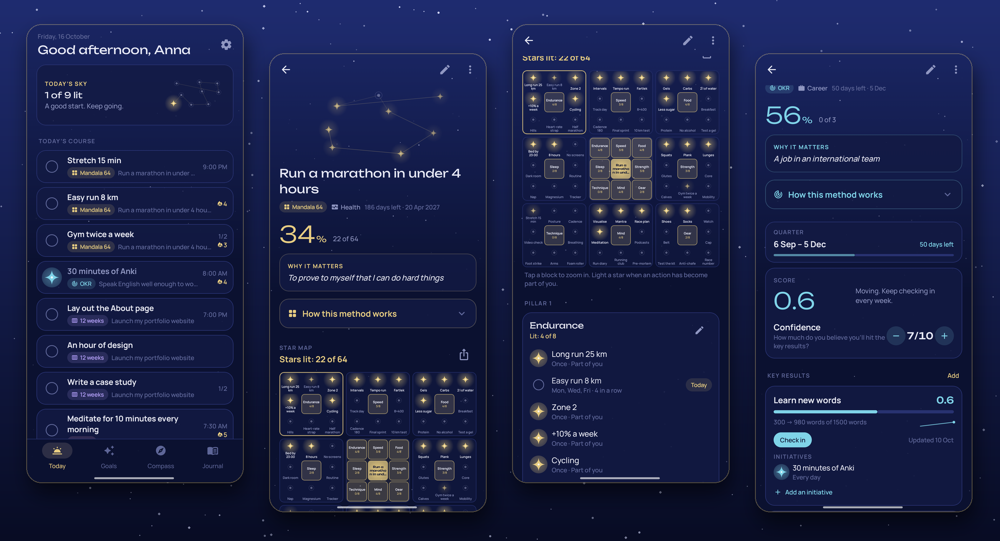
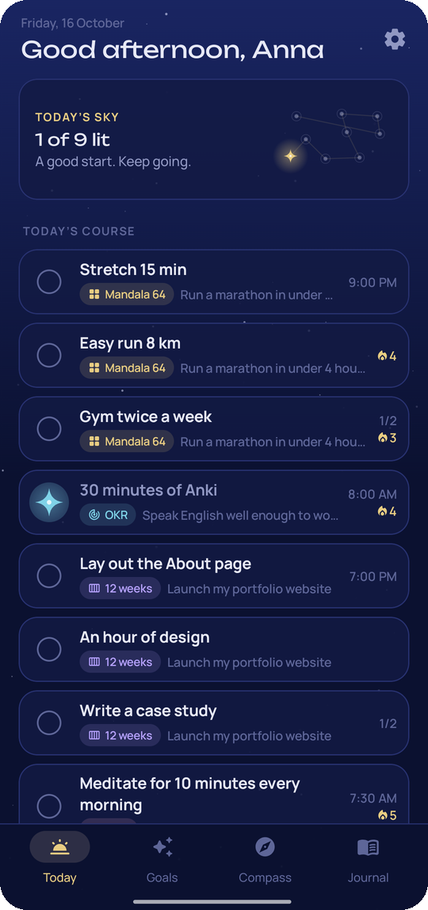
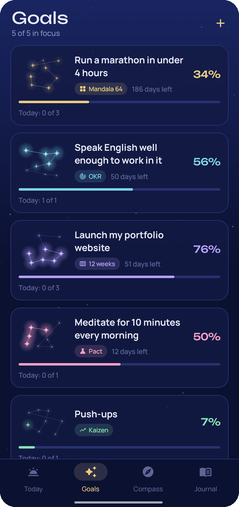
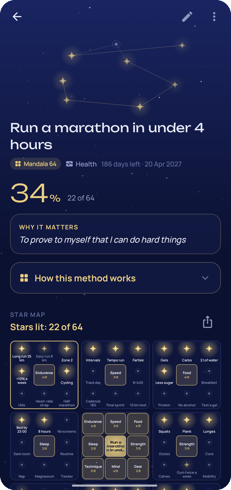
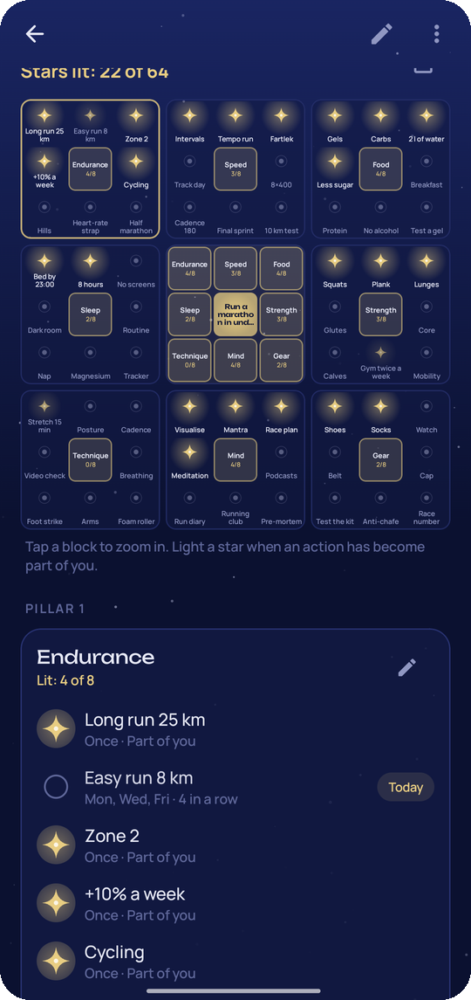
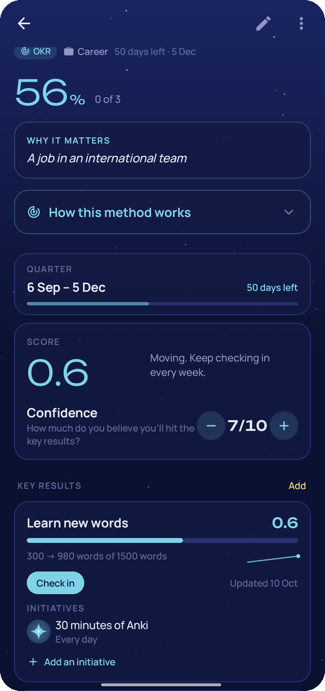
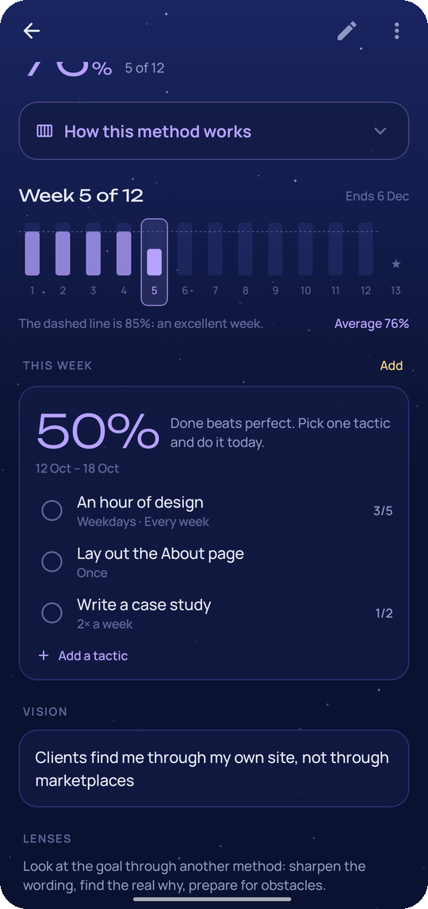
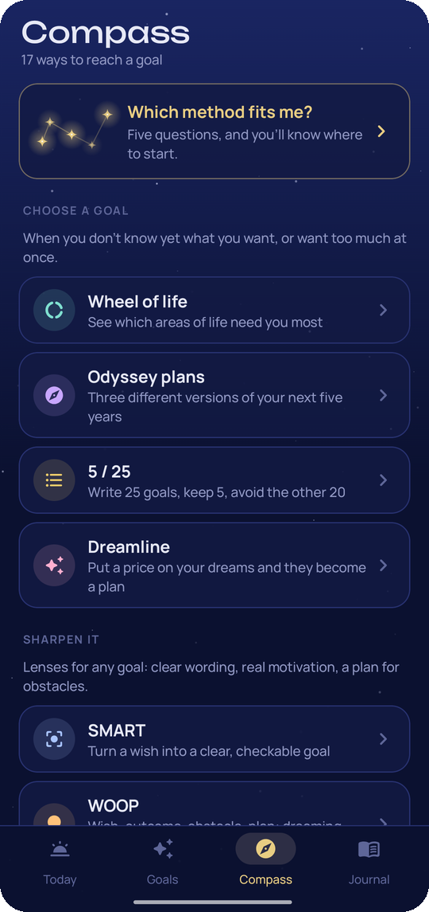
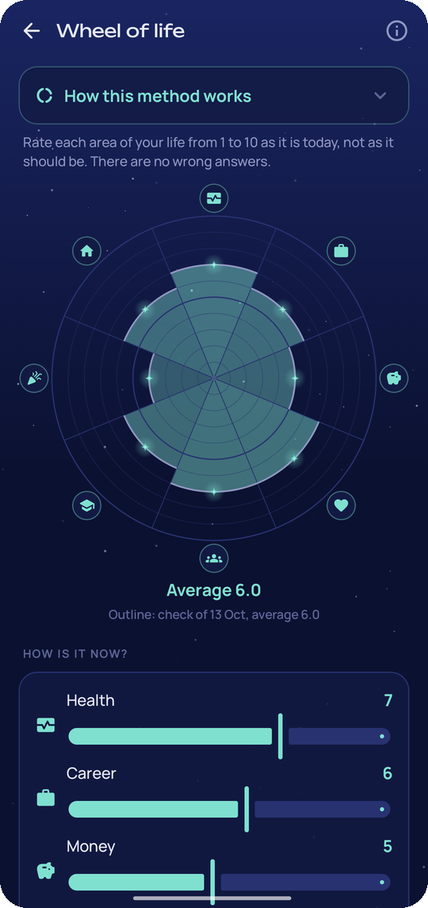

<div align="center">


# Waypoint

### Goals under a night sky

*17 proven methods for reaching a goal, in one free app. Break a dream into Ohtani's Mandala 64, run a quarter on OKRs, squeeze a year into 12 weeks, or just try something for 30 days. Every goal becomes a constellation, and every step you take lights a star. No ads, no account, works offline.*

[](https://github.com/bigdevwhale/waypoint/actions/workflows/android.yml)
[](https://github.com/bigdevwhale/waypoint/releases/latest)


[](LICENSE)

**English** · [Русский](README.ru.md) · [Website](https://bigdevwhale.github.io/stillcraft/apps/waypoint/) · [Changelog](CHANGELOG.md)



</div>

---

## The idea

There is no single right way to reach a goal. A marathon needs a different plan than a new language, and "I want to change my life" needs something else again. People have spent decades inventing methods for this: a Japanese coach's 9×9 chart, Intel's OKRs, a psychologist's if-then plans.

Waypoint puts the best of them in one place, explains each one, and helps you pick. A goal runs on one method and can borrow lenses from others. Whatever the method, today's steps from all your goals land on one screen.

## The methods

| | Group | Methods |
|---|---|---|
| 🧭 | **Choose a goal** | Wheel of life · Odyssey plans · 5/25 · Dreamline |
| 🔍 | **Sharpen it** (lenses for any goal) | SMART · WOOP · GROW · 5 whys |
| ✦ | **Drive it** (one per goal) | Mandala 64 · OKR · 12-week year · 4DX · 1% a day · 30-day pact · Reverse plan · Milestones |
| 🛡️ | **Protect it** | Pre-mortem |

Each method comes with what it is, its steps and where it comes from, right where you choose it and on the goal it drives. Not sure? Five questions in **Which method fits me?** suggest two methods and a lens.

## What's inside

| | Feature | How it works |
|---|---|---|
| ✦ | **Mandala 64** | Ohtani's chart as a star map: the goal in the centre, eight pillars, 64 actions. Make some habits, take others on as one-off steps, light a star when an action has become part of you. Share the chart as a poster. |
| 🎯 | **OKR** | An objective, 3–5 key results with start and target, check-ins with a history line, a 0–1 score, your confidence and initiatives under each result. |
| 📅 | **12-week year** | Weekly tactics, an execution score for every week against the 85 % line, a vision, and a review week 13 that starts the next year. |
| 📈 | **4DX, kaizen, pact, reverse plan, milestones** | A lead-measure scoreboard, a 1 %-a-day curve, a 30-star pact with persist / pause / pivot, a ladder from the finish back to today, plain milestones and habits. |
| 💡 | **Lenses** | SMART wording, WOOP if-then plans with reminders, GROW options, the five whys that end up on the goal card, a pre-mortem of how it could fail. |
| 🌅 | **Today** | One course for the day with steps from every goal, streaks, +1 counters and kaizen numbers. A backup course shows your if-then plans for when things go off track. |
| 🌌 | **Constellations** | Every goal has its own shape. Its stars light up as it moves, and reached goals stay in the journal as a wall of constellations. |
| 📓 | **Journal** | A weekly review (what went well, what got in the way, what to change, how the week felt), the wheel of life over time, reached goals and the ones you let go, with what they taught you. |
| 🎚️ | **Focus limit** | Choose how many goals can be active at once. The rest wait in the queue until a place frees up. |

<table>
  <tr>
    <td></td>
    <td></td>
    <td></td>
    <td></td>
  </tr>
  <tr>
    <td></td>
    <td></td>
    <td></td>
    <td></td>
  </tr>
</table>

## English & Русский

Every screen and every method guide is written natively in both languages. Switch in **Settings → Language**; on Android 13+ the app also appears in the system's per-app language settings.

## Download

Get the APK from **[Releases](https://github.com/bigdevwhale/waypoint/releases/latest)**, or the debug APK attached to any [CI run](https://github.com/bigdevwhale/waypoint/actions/workflows/android.yml). Waypoint needs Android 8.0 (API 26) or newer.

> [!TIP]
> On Xiaomi (MIUI / HyperOS), Huawei and some other phones, allow **Autostart** and remove battery limits so the morning course, the evening check and step reminders arrive on time.

## Privacy

Waypoint has no accounts, no servers, no analytics, no ads and no internet permission. Goals, steps, reviews and notes live on the phone. **Settings → Backup** exports everything to one JSON file you keep.

## Under the hood

- **Kotlin + Jetpack Compose**, Material 3 with a custom night palette (and a dawn one), the Unbounded and Manrope typefaces. The sky, the stars and the constellations are drawn on a `Canvas`.
- **Room** stores goals and one generic tree of steps: a mandala pillar, a key result, a 12-week tactic, a lead measure and an if-then plan are all `Node`s of different kinds. A day log, free-text fields, reviews, wheel checks and tool entries complete it. **DataStore** holds the settings.
- `domain/World` holds the shared rules: what is due today, streaks, 12-week scores, kaizen targets and each method's progress. The quiz scoring is a pure function with unit tests.

```
app/src/main/java/app/waypoint/
├── data/        Room database, settings, JSON backup, demo seed
├── domain/      methods, what's due today, streaks, scores, progress
├── notify/      morning course, evening check, weekly review, step reminders
├── widget/      today's course on the home screen
└── ui/          today, goals, compass, journal, the 8 methods, 5 lenses, 4 tools, quiz
```

Build it with `./gradlew assembleDebug`. `./gradlew installDebug -Pdemo` installs `app.waypoint.demo` with made-up goals, the one used for these screenshots.

## License

[MIT](LICENSE). Part of [Stillcraft](https://bigdevwhale.github.io/stillcraft/), small tools for a quieter mind.
