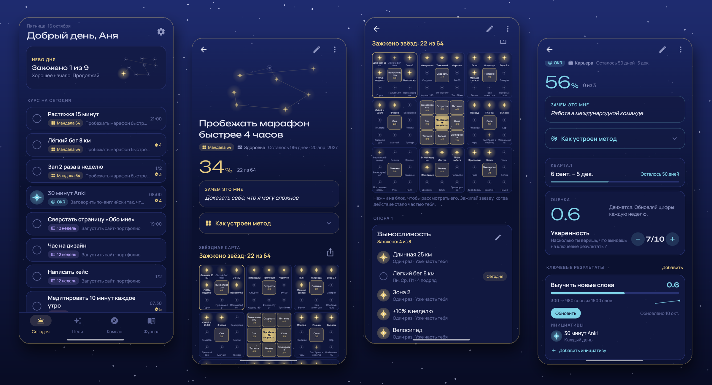
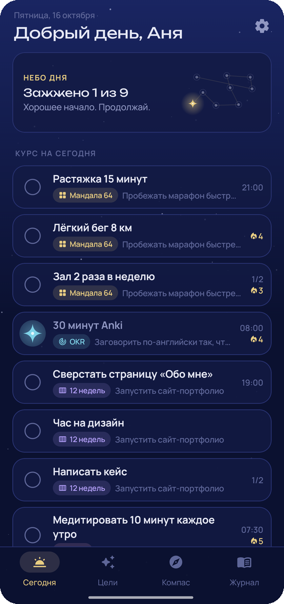
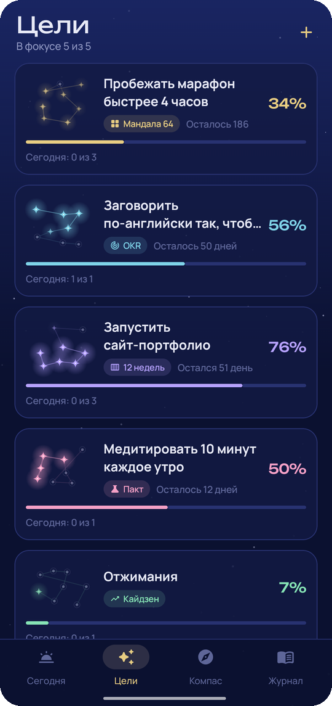
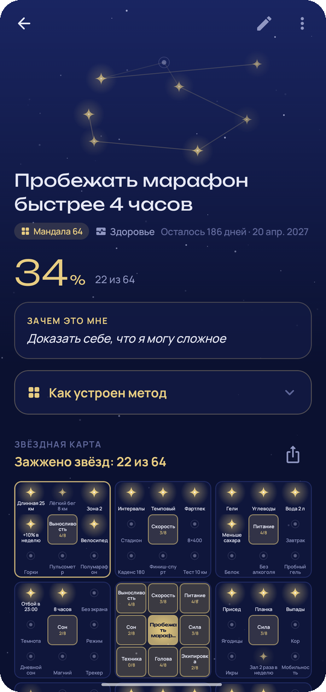
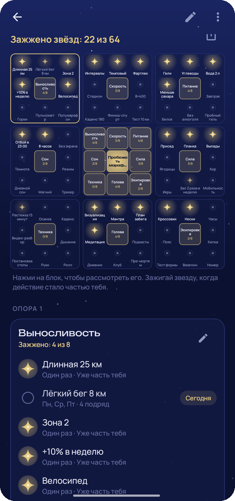
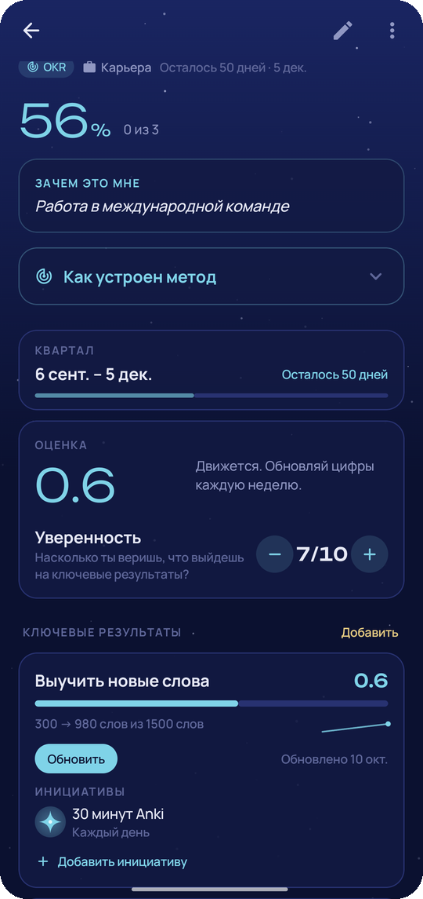
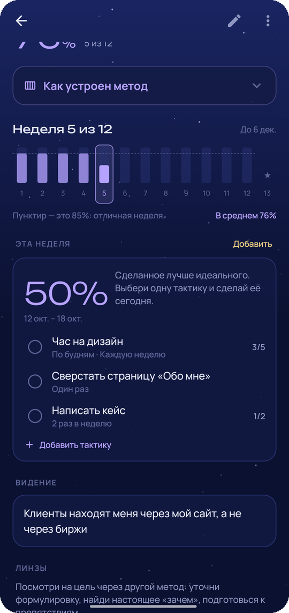
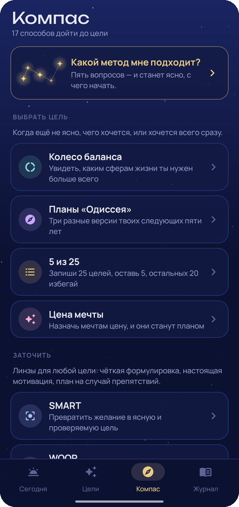
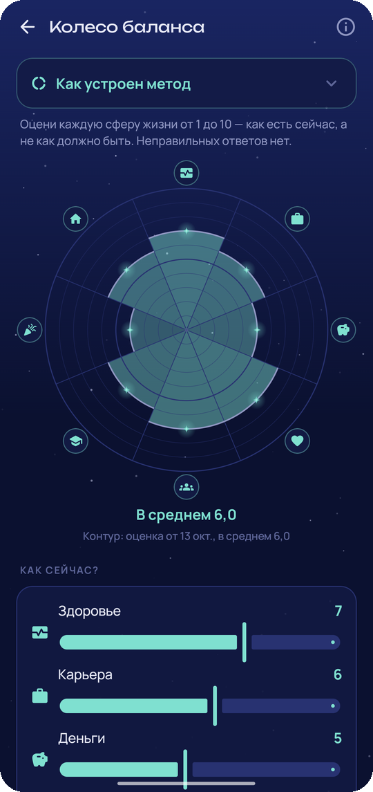

<div align="center">


# Waypoint

### Цели под ночным небом

*17 проверенных методов достижения целей в одном бесплатном приложении. Разложи мечту на Мандалу 64 Отани, проведи квартал по OKR, сожми год до 12 недель или просто попробуй что-то 30 дней. Каждая цель становится созвездием, а каждый сделанный шаг зажигает звезду. Без рекламы и аккаунта, работает офлайн.*

[](https://github.com/bigdevwhale/waypoint/actions/workflows/android.yml)
[](https://github.com/bigdevwhale/waypoint/releases/latest)


[](LICENSE)

[English](README.md) · **Русский** · [Сайт](https://bigdevwhale.github.io/stillcraft/apps/waypoint/) · [История изменений](CHANGELOG.md)



</div>

---

## Идея

Единственно верного способа дойти до цели не существует. Марафону нужен один план, новому языку другой, а «хочу изменить жизнь» требует чего-то третьего. Люди десятилетиями придумывали для этого методы: таблица 9×9 японского тренера, OKR из Intel, планы «если–то» психолога.

Waypoint собирает лучшие из них в одном месте, объясняет каждый и помогает выбрать. Цель ведёт один метод, а линзы можно брать у других. Каким бы ни был метод, шаги всех целей на сегодня оказываются на одном экране.

## Методы

| | Группа | Методы |
|---|---|---|
| 🧭 | **Выбрать цель** | Колесо баланса · Планы «Одиссея» · 5 из 25 · Цена мечты |
| 🔍 | **Заточить** (линзы для любой цели) | SMART · WOOP · GROW · 5 почему |
| ✦ | **Вести** (один на цель) | Мандала 64 · OKR · 12-недельный год · 4DX · 1% в день · Пакт на 30 дней · Обратный план · Вехи |
| 🛡️ | **Защитить** | Пре-мортем |

У каждого метода есть описание, шаги и история происхождения: там, где ты его выбираешь, и на цели, которую он ведёт. Не знаешь, что выбрать? Пять вопросов в разделе **«Какой метод мне подходит?»** подскажут два метода и линзу.

## Что внутри

| | Возможность | Как это работает |
|---|---|---|
| ✦ | **Мандала 64** | Таблица Отани в виде звёздной карты: цель в центре, восемь опор, 64 действия. Одни действия становятся привычками, другие берутся разовыми шагами, а звезда зажигается, когда действие стало частью тебя. Таблицей можно поделиться как постером. |
| 🎯 | **OKR** | Цель, 3–5 ключевых результатов со стартом и целью, отметки прогресса с графиком, оценка от 0 до 1, уверенность и инициативы под каждым результатом. |
| 📅 | **12-недельный год** | Тактики по неделям, процент исполнения каждой недели относительно линии 85 %, видение и 13-я неделя для разбора, с которой начинается следующий год. |
| 📈 | **4DX, кайдзен, пакт, обратный план, вехи** | Табло опережающих показателей, кривая «1% в день», пакт из 30 звёзд с выбором «продолжить / пауза / поворот», лестница от финиша до сегодня, простые вехи и привычки. |
| 💡 | **Линзы** | Формулировка по SMART, планы «если–то» по WOOP с напоминаниями, варианты по GROW, пять «почему», которые попадают на карточку цели, и пре-мортем того, как всё может пойти не так. |
| 🌅 | **Сегодня** | Один курс на день из шагов всех целей: серии, счётчики +1 и числа кайдзена. Запасной курс показывает твои планы «если–то» на случай, когда что-то пошло не так. |
| 🌌 | **Созвездия** | У каждой цели своя форма. Звёзды загораются по мере движения, а достигнутые цели остаются в журнале стеной созвездий. |
| 📓 | **Журнал** | Итоги недели (что получилось, что мешало, что изменить, какой была неделя), колесо баланса во времени, достигнутые и отпущенные цели с тем, чему они научили. |
| 🎚️ | **Лимит фокуса** | Выбери, сколько целей может быть в работе одновременно. Остальные ждут в очереди, пока не освободится место. |

<table>
  <tr>
    <td></td>
    <td></td>
    <td></td>
    <td></td>
  </tr>
  <tr>
    <td></td>
    <td></td>
    <td></td>
    <td></td>
  </tr>
</table>

## English и Русский

Каждый экран и каждое описание метода написаны на обоих языках, без машинного перевода. Язык меняется в **Настройки → Язык**; на Android 13+ приложение также есть в системных настройках языка для приложений.

## Скачать

APK лежит в **[Releases](https://github.com/bigdevwhale/waypoint/releases/latest)**, отладочный APK есть в каждом [прогоне CI](https://github.com/bigdevwhale/waypoint/actions/workflows/android.yml). Нужен Android 8.0 (API 26) или новее.

> [!TIP]
> На Xiaomi (MIUI / HyperOS), Huawei и некоторых других телефонах разреши **автозапуск** и сними ограничения батареи, чтобы утренний курс, вечерняя проверка и напоминания о шагах приходили вовремя.

## Приватность

У Waypoint нет аккаунтов, серверов, аналитики, рекламы и доступа в интернет. Цели, шаги, итоги и заметки хранятся в телефоне. **Настройки → Резервная копия** сохраняет всё в один JSON-файл, который остаётся у тебя.

## Как устроено

- **Kotlin + Jetpack Compose**, Material 3 с собственной ночной палитрой (и рассветной), шрифты Unbounded и Manrope. Небо, звёзды и созвездия рисуются на `Canvas`.
- **Room** хранит цели и одно общее дерево шагов: опора мандалы, ключевой результат, тактика 12 недель, опережающий показатель и план «если–то» — это `Node` разных видов. Дополняют его дневной журнал отметок, текстовые поля, итоги недель, оценки колеса и записи инструментов. **DataStore** хранит настройки.
- В `domain/World` собраны общие правила: что делать сегодня, серии, оценки 12 недель, цели кайдзена и прогресс каждого метода. Подсчёт результатов квиза — чистая функция с юнит-тестами.

```
app/src/main/java/app/waypoint/
├── data/        база Room, настройки, JSON-копия, демо-данные
├── domain/      методы, план на сегодня, серии, оценки, прогресс
├── notify/      утренний курс, вечерняя проверка, итоги недели, напоминания
├── widget/      курс на сегодня на главном экране
└── ui/          сегодня, цели, компас, журнал, 8 методов, 5 линз, 4 инструмента, квиз
```

Сборка: `./gradlew assembleDebug`. `./gradlew installDebug -Pdemo` ставит `app.waypoint.demo` с выдуманными целями, по нему сделаны эти скриншоты.

## Лицензия

[MIT](LICENSE). Часть [Stillcraft](https://bigdevwhale.github.io/stillcraft/) — небольших инструментов для спокойного ума.
